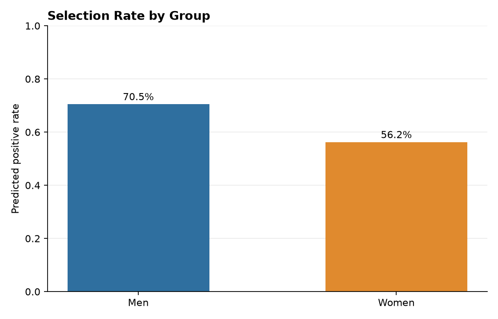
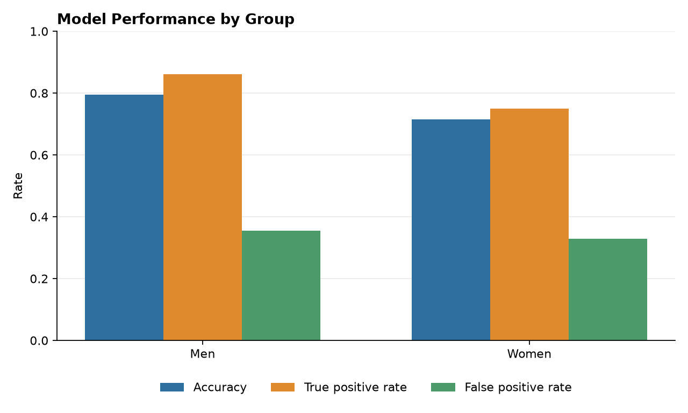

# FairAI Bangladesh: Responsible AI Audit Report

## Scope

This report audits a baseline classifier on **synthetic demonstration data**. It is not an assessment of real hiring practices or a legal compliance opinion.

## Dataset overview

- Rows: 1200
- Features: test score, experience years, education, career gap years (a proxy correlated with group)
- Group column: `gender_group`
- Overall positive target rate: 0.627
- Missing values: none

| group   |   n |   positive_rate |
|:--------|----:|----------------:|
| Men     | 620 |           0.694 |
| Women   | 580 |           0.557 |

## Group metrics (test set)

| group   |   n |   selection_rate |   accuracy |   true_positive_rate |   false_positive_rate |   false_negative_rate |
|:--------|----:|-----------------:|-----------:|---------------------:|----------------------:|----------------------:|
| Men     | 156 |            0.705 |      0.795 |                0.861 |                 0.354 |                 0.139 |
| Women   | 144 |            0.562 |      0.715 |                0.75  |                 0.328 |                 0.25  |

## Fairness summary

- Demographic parity difference (max selection rate - min): **0.143**
- Disparate impact ratio (min selection rate / max): **0.798**
- Equal opportunity difference (max TPR - min TPR): **0.111**

These values are descriptive signals, not automatic pass/fail judgments. The acceptable level of difference depends on context, measurement quality, sample size, law, and stakeholder input.

## How to read the metrics

- **Selection rate:** share of a group predicted positive.
- **Demographic parity difference:** gap between the highest and lowest selection rates. 0 means equal rates.
- **Disparate impact ratio:** lowest selection rate divided by the highest. Closer to 1 means more similar rates. A common screening heuristic is 0.8 (the "four-fifths rule"), but it is a rule of thumb, not proof of fairness or unfairness.
- **Equal opportunity difference:** gap in true positive rates, i.e. how often qualified people in each group are correctly selected.

## Possible mitigation steps

- Review how the labels were created and whether they encode past bias.
- Check whether features act as proxies for group membership.
- Try re-weighting or re-sampling training data, or group-aware threshold tuning, and re-measure.
- Compare several metrics together; improving one can worsen another.
- Keep a human review step and document decisions in a model card.

## Interpretation checklist

- Check group sample sizes and data quality.
- Compare false-positive, false-negative, and true-positive rates as well as selection rates.
- Investigate how labels were created and whether features are valid for the intended use.
- Consult affected stakeholders and qualified legal and ethics experts before deployment.
- Do not use this synthetic demo to screen real applicants.

## Limitations

- Synthetic data may not reflect real populations or social processes.
- The group column is not a model input, but a correlated proxy feature (career gap years) can still carry group information.
- Only a binary group field is represented; identities and intersections are more complex.
- The audit examines one train/test split and one baseline model, with no confidence intervals.
- Statistical parity alone does not establish fairness.
